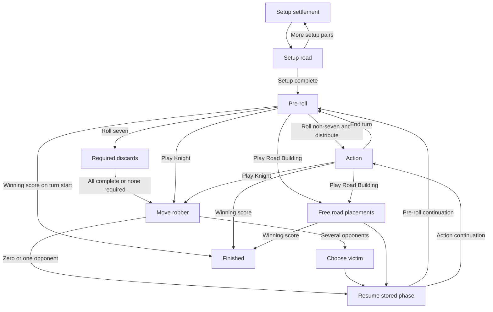

# Spec: turn-engine

Status: approved as the planning baseline on 9 November 2026. Depends on
`game-model` and `base-rules`; does not import `engine-api`. The user
subsequently authorized autonomous implementation; [tasks/todo.md](tasks/todo.md)
records verified status.

## Objective

Make the base game playable from creation through victory by executing typed
player commands, enforcing who can act, sequencing required decisions, and
returning deterministic transitions. A UI must not need to infer a rule or
advance a hidden phase on its own.

## Provider contract

The conceptual entry points are:

```rust
pub fn create_game(
    config: &GameConfig,
    seed: [u8; 32],
) -> Result<CreatedGame, RuleError>;

pub fn validate_action(
    board: &Board,
    state: &GameState,
    actor: PlayerId,
    command: &Command,
) -> Result<(), RuleError>;

pub fn evaluate(
    board: &Board,
    state: &GameState,
    actor: PlayerId,
    command: &Command,
) -> Result<Transition, RuleError>;
```

Names and signatures illustrate the required shape, not a saved implementation.
`Transition` owns the next compact position, next revision, an optional changed
random state, and an ordered, bounded-per-command event list. No random update
means the facade retains its existing generator; nonrandom commands need not
clone it. It never mutates the borrowed input. `engine-api` commits the complete
successful result together, without exposing an intermediate state.

Action validation has one path: actor/phase checks here, then rule calculations
in `base-rules`. Queries use that same path or its shared predicate helpers;
execution does not trust an earlier UI query. Parsing and externally supplied
revision checks belong to `engine-api`.

### Creation

- Accept a validated player count and ordered seats, plus `fixed` or `variable`
  setup. No rule-variant options are exposed in this release.
- Create the board from the pinned layout/procedure, initialize supplies,
  shuffle development cards, and determine the starting seat using dice.
- Tie policy is an approved digital completion of the rulebook procedure:
  reroll only the highest tied seats until one remains. These selection rolls
  do not produce resources or count as gameplay turns.
- In fixed setup, install the source's preset pieces, map the seats to its
  preset roles, omit White with three players, and issue the second-settlement
  starting hands. Enter the first player's pre-roll phase.
- In variable setup, begin with an empty board in first-round settlement
  placement. Hands remain empty until all setup pairs are complete; then issue
  each second settlement's starting resources and begin turn 1.
- Initial revision is 0; setup uses turn number 0. Normal turns start at 1.
  Creation returns public setup/starter-roll events through a host receipt.
  Invalid creation returns an error without a partially usable game.

### Explicit phase machine

| Phase | Permitted actor / commands | Completion / next state |
|---|---|---|
| `SetupSettlement` | Current setup seat: `placeSetupSettlement` | Store this vertex and move to `SetupRoad`. |
| `SetupRoad` | Same seat: `placeSetupRoad` adjacent to that vertex | Advance the forward/reverse setup order; after the final pair, grant starting hands and begin the first turn. |
| `PreRoll` | Active seat: `rollDice`, or play an eligible Knight/Monopoly/Invention/Road Building | A resolved non-seven roll enters `Action`; a seven begins mandatory resolution. A pre-roll card returns here after its effect unless victory ends play. |
| `Discard` | Any seat with an outstanding obligation: `discardResources` | Clear that seat's obligation. When all are done, enter `RobberMove` with `Action` as continuation. |
| `RobberMove` | Active seat: `moveRobber` to another hex | No adjacent opponents: continue immediately. One opponent: automatically resolve its steal attempt. Multiple opponents: enter `RobberVictim`. |
| `RobberVictim` | Active seat: `chooseRobberVictim` among adjacent opponents | Resolve one random-card attempt, then return to the stored continuation. An empty-handed victim transfers nothing. |
| `FreeRoads` | Active seat: `placeFreeRoad` on a legal edge | Apply the road, reconcile awards, and check victory. After the first road, request the mandatory second if legal sites and a road piece remain; otherwise return to the stored continuation automatically. Never request an impossible placement or permit voluntary forfeiture. |
| `Action` | Active seat: paid building, buy/play development cards, bank trade, end turn. Trade-offer commands can also come from an eligible counterpart. | Stay here after each resolved action; Knight/Road Building create pending phases; `endTurn` starts the next seat. |
| `Finished` | No gameplay commands | Views, snapshot export, and replay inspection remain available. |

Phase payloads store the origin of a robber effect (`seven` or `knight`) and
its continuation (`PreRoll` or `Action`). Free-road payloads similarly store
remaining placements and continuation. Do not rely on an implicit call stack
that is lost when the host saves or exits.



The diagram omits immediate Monopoly/Invention self-transitions and the
score check on Knight reveal. BR037–BR038 always override pending phases.

### Turn and card sequencing

1. Start the next seat, increment the turn number, clear the new turn's
   non-VP-card allowance, and check its true score before requesting a roll.
2. Pre-roll cards finish before rolling. Monopoly and Invention include their
   complete resource choice in the play command; Knight and Road Building
   create explicit pending decisions.
3. A Knight is marked played before its robber resolution. Update Largest
   Army and check victory at that step; an immediate win cancels the pending
   robber action. Otherwise continue normally.
4. A seven fixes each discard requirement using the hand at that roll. Accept
   required discards in arrival order; do not require one arbitrary seat to
   block everyone else. Trading/card plays/turn ending are unavailable.
5. Each discard obligation can be fulfilled only once. No repeated halving
   even if a player still has more than seven cards afterward.
6. Only after all obligations finish may the active seat move the robber.
   An eligible victim is an adjacent opponent, including one with no cards.
7. Place free roads sequentially, using the updated first-road position for
   the second. No paid action, trade, or another card interrupts this effect.
   Reject activation without card/allowance consumption if no legal road/piece
   exists. After the first road, require the second only while possible; finish
   automatically otherwise. Invention requires two available bank cards, or
   the sole remaining card when total bank stock is one; empty-bank activation
   rejects without consuming the card/allowance. Follow approved RQ1/RQ2.
8. After `endTurn`, remove an outstanding offer, switch the active seat, and
   run the turn-start victory check in the same accepted transition.
9. A win records winner/final scores, reveals the winner's VP cards, clears
   continuations and offers, and rejects all subsequent gameplay actions.

### Transaction and error semantics

- Validate actor, phase, IDs, costs, availability, and effect choices against
  the current input state. Construct a private next-state value; commit none
  of it to the caller's original state during evaluation.
- Increment revision exactly once per accepted command, including offer
  creation/rejection/cancellation and setup placement. Automatic consequences
  inside that command do not add extra revisions.
- Unknown/invalid command, wrong seat/phase, an illegal placement, wrong
  discard quantity, missing resources/cards, or failed effect choice returns
  a typed error. It cannot consume a card, spend resources, use a die result,
  advance the RNG, change an offer, or advance the turn.
- Use checked counters for revisions/turns. Counter exhaustion returns an
  error, not wraparound. A panic is an engine defect, not a gameplay rejection.
- No public undo command. Callers needing independent analysis can explicitly
  retain a snapshot or previous immutable state; normal play never rewrites
  accepted history.

### Randomness and determinism

- Use one explicit `ChaCha12Rng` from `rand_chacha` 0.10.0, seeded with 32 bytes
  supplied by the trusted host. The stream ID is fixed at zero in version 1.
  Never call a thread/global RNG, OS entropy, or wall clock inside a transition.
- The host must use an unpredictable seed and keep it private for fair hidden
  play. A publicly chosen seed permits prediction of dice and deck order.
- One generator drives setup shuffles, starter rolls, production dice, and
  robber draws in a defined order. Queries do not consume it. Development-card
  purchases take the next already shuffled card rather than reshuffling.
- Creation order is terrain shuffle, then sea-frame shuffle for variable
  setup only; then development-deck shuffle for either setup; then starter
  rolls in supplied seat order, followed by tied-highest rerolls in that same
  order. Fixed setup consumes no terrain/frame shuffle draws. Number placement
  uses the fixed top-right spiral in BR006 and consumes no randomness.
  Each dice pair samples its first die before its second. A nonempty theft
  samples one card index in brick/wood/wool/wheat/ore cumulative-count order;
  an empty victim consumes no draw. Source fixture arrays and these operations
  must have golden tests before random algorithm version 1 is frozen.
  Variable terrain starts from `fixed.terrainByHex` in graph-ID order in
  `tests/support/setup.json`; frame shuffle input is template IDs `[1,2,3,4,5,6]`
  in that fixture's `fixedFramePermutation` order. The captured component
  display order is not a shuffle input. This pins the implementation detail
  needed for exact seed-to-layout replay without changing the setup rules.
- Dice and card-index choices use the dependency's unbiased sampling routines;
  do not use modulo reduction or uniformly choose a resource type.
  With the pinned rand 0.10.3 default features disabled, use a constructed
  `Uniform` distribution and `Distribution::sample`: the single-value
  `random_range` sampler does not guarantee exact unbiasedness without rand's
  optional `unbiased` feature. Enable that feature because `SliceRandom::shuffle`
  also uses the single-value sampler internally. The feature adds no dependency
  or entropy source. This selects the approved unbiased behavior before the
  algorithm's goldens are frozen and preserves the creation operation order.
- Clone generator state only into the private evaluation result when random
  output is required. A rejection returns without changing the original.
- Pin the sampler implementation through `Cargo.lock` and a declared
  `randomAlgorithm` version. Golden tests lock the random sequence and resulting
  games. A dependency update that changes outputs is a compatibility decision,
  not an unnoticed lockfile refresh.
- Snapshot reconstruction uses seed plus the generator's word position,
  with stream zero. Its 68-bit word position is encoded as a decimal string and
  checked below `2^68` before applying it; the generator must not silently mask
  an invalid imported high value.
- Equivalent initial board/config/random state and accepted command sequence
  produce equivalent states and event order across supported native and Wasm
  targets. Unordered-map iteration must not influence rule or random order.

### Events and replay responsibilities

Return enough event facts for a UI to explain dice, production, discards,
placements, trades, purchases/plays, robber movement/theft, award transfer,
turn changes, and victory. Full facts can include private resource/card types;
`engine-api` supplies viewer-safe projections.

Events are explanations of the completed transition, not a second engine that
applies its own rules. Deterministic replay re-executes accepted typed commands
against an initial snapshot. Do not introduce event sourcing or reconstruct
current state by scanning the whole event history on every action.

The current `GameState` stores no complete log. Replay records are collected
by a caller from receipts; saving a current position can omit historical events
without losing the ability to resume play.

## Project Structure

The original illustrative file plan under `src/turn_engine/` was: `mod.rs`, `create.rs`, `validate.rs`,
`execute.rs`, `phase.rs`, `random.rs`, and `queries.rs` when each earns a file.
Integration tests live in `tests/game_sequences.rs` and `tests/replay.rs`.

## Code Style

- Exhaustively match phase/command enums; keep phase updates explicit.
- Private helpers own clear responsibilities; avoid global state, callback
  chains, an async runtime, per-rule traits, and generic workflow engines.
- Return `Result<Transition, RuleError>` consistently. An ordinary rejected
  move is not `panic!`, an exception-like sentinel, or a partial success.
- Follow [SPEC.md](SPEC.md) and [CONSTRAINTS.md](CONSTRAINTS.md).

## Commands

Focused local checks:

```bash
cargo test --locked turn_engine_
cargo test --locked --test game_sequences
cargo test --locked --test replay
cargo bench --locked --bench engine native/
cargo clippy --locked --all-targets -- -D warnings
```

## Testing Strategy

- Walk complete 3- and 4-player games through only public commands, from each
  setup mode to victory. Assert every phase change and all state invariants.
- Table-test actor/command eligibility in every phase, with illegal cross-turn
  commands and duplicate discard submissions.
- Save/resume before a setup road, before rolling, during several outstanding
  discards, after robber movement but before victim choice, and between free
  roads. Resume with the same next result and continuation.
- Assert byte-equivalent snapshots/RNG position/revisions for rejected
  commands. Include an invalid card choice that could otherwise consume RNG.
- Verify pre-roll card returns to `PreRoll`, a pre-roll Knight followed by
  a seven moves the robber twice, and the one-card allowance spans both phases.
- Verify a third Knight win and first-free-road win stop immediately; a player
  with 10 off-turn waits until its own turn unless another active player wins.
- Fixed seeds exercise setup, exact dice pairs, weighted theft, shuffling, and
  deterministic replay. Statistical smoke tests complement exact checks but
  do not replace testing correct uniform sampling.
- Benchmark complete accepted and rejected commands with invariants intact;
  include late-game road graphs and public-boundary cost separately.

## Boundaries

- Always: use the shared rules, preserve atomicity/determinism, report next
  required actors/choices explicitly, and check immediate victory.
- Ask first: alter command meaning, automatic decision policy, RNG behavior,
  or the approved RQ1/RQ2 card policies.
- Never: choose a player's discard/resource/victim strategy, expose a seed to
  a player view, accept forged dice results, start timers, send network calls,
  or use UI code to complete a phase.

## Success Criteria

- Both setup modes lead to complete legal games without UI-side rule logic.
- All decision phases resume from snapshots and preserve the next random result.
- Failed commands change nothing, including revision and generator state.
- Queries and execution agree on action legality, and complete command traces
  replay with the same state and ordered events.

## Open Questions

RQ1/RQ2 in [SPEC-base-rules.md](SPEC-base-rules.md) are resolved by approved
engine policies. The starter-roll tie policy is approved with the planning
baseline; no independent rule-variant mechanism is planned.
