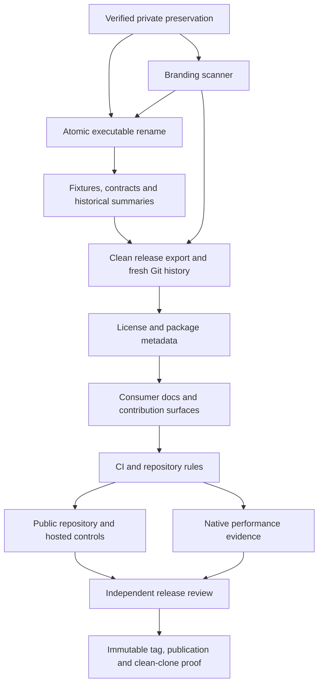
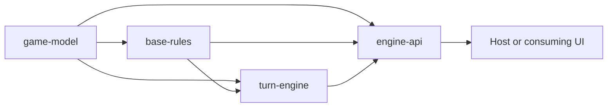

# Implementation Plan: Hex Traders Release

Status: approved for autonomous implementation on 13 November 2026 by the user's
`$build auto` invocation, including the documented T37 atomic size exception.
The user previously approved the release capability map and advanced the two
specifications to planning by invoking `$plan`. This section extends the completed engine plan; it does not replace its
history. Execution status is recorded only in [todo.md](todo.md#hex-traders-release).
Implementation begins with privately verified preservation; actual completion
is recorded in the task list.

## Governing contract and scope

[Root specification](../SPEC.md),
[branding specification](../SPEC-hex-traders-branding.md),
[publication specification](../SPEC-github-publication.md), and the
[approved release map](../CAPABILITY-MAP-hex-traders-release.md) govern this work.
[CONSTRAINTS.md](../CONSTRAINTS.md) retains every existing threshold and policy.

Deliver a fully renamed native Rust engine in a local `Hex-Traders` checkout,
then public `strange0g/hex-traders` with dual MIT OR Apache-2.0 licensing, protected
branches, enforced CI, and verified `v0.1.0`. The package/import become
`hex-traders-engine` / `hex_traders_engine`; rules identifier becomes
`hex-traders-base-v1`. Schema/API/replay versions and deterministic RNG remain
unchanged. There are no old saves to migrate.

The existing four-module architecture, BR001–BR038, RQ1/RQ2, privacy, atomicity
and replay semantics remain authoritative. UI, hosted gameplay, registry
publication and paid features remain outside this release.

## Dependency graph and working-state strategy

Provider → consumer direction:



Work initially in an isolated preparation branch with the existing history.
First preserve and verify original source, Git refs, checkpoint/oracle archives,
performance evidence and notices privately. Every implementation task receives
its own verified commit there. No preparation refs are pushed.

After executable/doc cleanup, T45 exports an explicit checked file set into the
destination and initializes fresh Git history. Original evidence archives,
indices, specialist reports and pre-rename Git objects remain in private
preservation. The public tree retains accurate historical summaries and fresh
proof; it does not contain renamed copies of original logs. All later commits
occur in the fresh repository and must pass the history gate.

The intended export includes engine source/configuration, tests and frozen
fixtures, benchmarks, root/provider/quality/performance documents, portable task
and checkpoint derivatives, fresh `tasks/evidence/release/` records, and
unchanged `.agents/` and `.codex/` tooling with its notices. T45 records the exact
checksummed relative-path export manifest. Original `tasks/evidence/` archives,
indices and validation records, `tasks/ship-reports/`, `tasks/c11-evidence.tar.gz`,
`performance/evidence/` and `performance/review-t31.md` remain private. Original
Git metadata, refs, alternates, build outputs and caches are excluded. The
public evidence index is a new derivative; original evidence is never renamed
or copied into the public tree. Every public local reference must resolve in
the exported set.

Keep original T01–T34 and C01–C11 completion evidence intact during preparation.
Their public derivative summaries must be explicitly identified as historical,
retain verified facts/IDs and resolve portable public links. Exact original bytes
and original per-task commits remain privately recoverable. Do not mark a fresh
gate passed using old measurements.

## Task sizing and verification

Nineteen tasks are listed below, with ten checkpoints after pairs and at final
publication. Ordinary tasks target at most five implementation/configuration/
documentation files, with task-status updates and one compact evidence record
handled by the coordinator. Retain detailed raw evidence in checksummed archives
when appropriate.

**T37 has one explicit task-size exception for approval:** inspection found 44
coupled manifest, caller, rustdoc, test, fixture and benchmark files. Crate/import
and rules-identifier changes must be applied atomically so every committed state
builds and passes the complete suite. Splitting this mechanical rename would
require temporary aliases or inconsistent persistence identifiers. Keep it to
these replacements and relevant assertions, within one focused session; no
refactoring, dependency changes or rule changes belong in T37. The approved
quality bar is unchanged. The actual file list is recorded before editing.

T35/T45 preserve/export whole existing trees through standard file/Git tools;
their broader copy footprint is not a new implementation subsystem. Use a
manifest, safe regular paths and byte hashes; do not create a general packaging
framework.

Per-task evidence records input revision, paths, exact checks, exit codes and
limitations before recording completion. Apply the standing definition of done
and [constraint check cadence](../CONSTRAINTS.md#check-cadence-and-protecting-the-bar).
Run relevant controls while editing and full required checks for executable
changes and final handoffs. Documentation-only edits use link/provenance checks;
README changes also run rustdoc because the README is the crate documentation.
Do not repeat unaffected engine tests for pure historical-summary changes.

Before T45 the complete preparation tree/history intentionally still contains
private historical material. Scanner self-tests must pass; any full-tree finding
is recorded as unresolved branding, never ignored or reported as a pass. The
complete source/archive/history gate becomes mandatory for the exported public
tree at C17 and every subsequent candidate.

## Standing release commands

Run from the current preparation or fresh checkout as appropriate; never execute
commands from an archived historical script merely because a report references it.

```bash
cargo check --locked --all-targets
cargo build --locked --release
cargo fmt --all -- --check
cargo clippy --locked --all-targets -- -D warnings
cargo test --locked --lib --tests
cargo test --locked --doc
cargo doc --locked --no-deps
cargo llvm-cov --locked --lib --tests --ignore-filename-regex '(^|/)(tests|benches)/' --fail-under-lines 90
cargo deny --locked check advisories
cargo bench --locked --bench engine -- --test
python3 scripts/check-branding.py --self-test
python3 scripts/check-branding.py
python3 scripts/check-branding.py --history
cargo package --locked --list
git diff --check
```

The scanner is implemented in T36. Coverage remains at least 90%; all tool and
advisory-refresh errors fail their gates. Review dependency direction, unchanged
rule assertions and fixture facts manually. Preserve exact commands/results for
fresh evidence; no secrets or original absolute paths enter public logs.

T51 records a new native reference run and variability with the existing fixture
and sampling policy, using:

```bash
cargo bench --locked --bench engine -- --save-baseline approved
cargo bench --locked --bench engine -- --baseline approved
HEX_TRADERS_MEMORY=1 HEX_TRADERS_MEMORY_COUNT=16 cargo bench --locked --bench engine
HEX_TRADERS_MEMORY=1 HEX_TRADERS_MEMORY_COUNT=64 cargo bench --locked --bench engine
```

Record CPU/RAM/OS/toolchain/profile/affinity/load and actual allocation evidence.
Compare against the privately preserved approved baseline under matching
conditions. Repeat ambiguous differences; the unchanged 5% review margin is
manual, with no new absolute budget. Hosted runners do not establish comparable
timing or memory performance.

## Ordered task index

| Phase | Task | Result | Depends on |
|---|---|---|---|
| Preservation and detector | [T35](todo.md#t35) | Recoverable private original baseline | — |
| | [T36](todo.md#t36) | Fail-closed naming gate with controls | T35 |
| | [C12](todo.md#c12) | Preservation and detector verified | T35–T36 |
| Executable identity | [T37](todo.md#t37) | Complete working native rename | T35–T36 |
| | [T38](todo.md#t38) | Portable source-traced fixture provenance | T37 |
| | [C13](todo.md#c13) | Create/save/replay and fixture facts verified | T37–T38 |
| Governing documents | [T39](todo.md#t39) | Renamed provider/root specifications | T37 |
| | [T40](todo.md#t40) | Honest quality/performance documentation | T37 |
| | [C14](todo.md#c14) | Rules and quality policies preserved | T39–T40 |
| Checkpoint provenance | [T41](todo.md#t41) | C03–C06 public historical summaries | T35 |
| | [T42](todo.md#t42) | C07–C10 public historical summaries | T35 |
| | [C15](todo.md#c15) | Original bytes and summary facts reconciled | T41–T42 |
| History completion | [T43](todo.md#t43) | Review/handoff/property summaries | T41–T42 |
| | [T44](todo.md#t44) | Complete task history and portable tooling | T38–T40, T43 |
| | [C16](todo.md#c16) | Export inputs and exclusions reviewed | T43–T44 |
| Fresh repository | [T45](todo.md#t45) | Verified fresh history and relocated checkout | T36, T44 |
| | [T46](todo.md#t46) | Licensed package and initial changelog | T45 |
| | [C17](todo.md#c17) | Entire export/archive/history naming gate passes | T45–T46 |
| Consumer/maintenance paths | [T47](todo.md#t47) | Usable guide, contribution and security contact | T46 |
| | [T48](todo.md#t48) | Issue/PR forms and dependency-update PRs | T46 |
| | [C18](todo.md#c18) | Consumer and contributor paths verified | T47–T48 |
| Hosted enforcement | [T49](todo.md#t49) | Pinned CI and reviewable rulesets | T36, T45–T48 |
| | [T50](todo.md#t50) | Public repository with verified protections | T49; authenticated owner |
| | [C19](todo.md#c19) | Hosted green checks and rejected-change controls | T49–T50 |
| Release review | [T51](todo.md#t51) | Fresh native timing/memory evidence | T49 |
| | [T52](todo.md#t52) | Independent assessed release candidate | T50–T51 |
| | [C20](todo.md#c20) | No unresolved release-blocking findings | T51–T52 |
| Publication | [T53](todo.md#t53) | Immutable v0.1.0 and clean-clone integration | T52 |
| | [C21](todo.md#c21) | Published release and completion evidence verified | T53 |

## GitHub execution and failure controls

Recheck authenticated identity at build preflight. If login remains invalid,
use a secure sign-in flow while independent local work continues. Never request
or print tokens in chat. Confirm `strange0g` and inspect the destination before
any remote mutation; preserve unrelated existing remote content.

Only the C17-verified fresh repository is published. T49 pins verified upstream
action commits, runs all three stable required checks, and fetches complete
candidate/default/release history for the naming gate. T50 creates the repository,
observes bootstrap results, then enables and reads back main/tag protections and
security features. All subsequent main updates go through the configured PR
checks. Zero required human approvals supports the sole maintainer; independent
review remains required by the release specification.

Hosted failure controls must not commit or expose a former-name literal in public
branches, PR bodies or log output. Construct prohibited content at runtime in
disposable temporary repositories; report neutral diagnostics and expected exits.
Use separate disposable changes to prove formatting/test/coverage/advisory and
tool-error failures block merge. Never lower the production threshold, introduce
public private data, or merge a control. Use safe ruleset evaluation or rejected
update attempts to verify enforcement without modifying protected main/tags.

Release notes/changelog are prepared before T52 review. After all checks pass for
the assessed revision, T53 publishes an annotated `v0.1.0` tag and GitHub release
with `--verify-tag`; validate the tag's exact peeled commit. Post-publication
completion evidence can follow in a documentation-only PR with required checks.
The release tag remains fixed, and any later main revision is identified
separately. Do not retag merely to include the completion record.

## Risk handling and recovery

| Risk | Effect | Handling |
|---|---|---|
| Mechanical edits change game facts or resolved dependencies | Replay/rule regression | T37 literal-scope audit, independent fixture comparison, complete tests and graph comparison against private original. |
| Archive/history cleanup erases original evidence | Prior verified work cannot be recovered | T35 restorable private copy precedes cleanup; preserve byte hashes, refs and original notices. |
| Public export contains old/private material | Violates identity/privacy requirement | Explicit export manifest, recursive archive and reachable-object checks, package/source-archive inspection and clean remote clone. |
| Relocation cannot update the active workspace | Later commands target a stale path | Verify destination first, obtain needed filesystem access, update supported app/project paths, use explicit destination workdirs; retain the recoverable original until usable. |
| GitHub authentication or destination conflict | Remote work cannot proceed | Secure owner login, read-only destination inspection, continue independent local tasks; never overwrite unrelated history. |
| Workflows are green but do not enforce failure | Broken changes can merge | Local negative/tool-error controls, real hosted control PRs, actor-aware ruleset readback and rejected-update proof. |
| A control itself publishes the prohibited name | Public history still contains a mention | Generate control payloads only in temporary runtime fixtures with neutral diagnostics; public control commits contain no literal. |
| New native measurements drift | Unsupported performance claim or regression | Same reference conditions, raw samples/repeats, unchanged manual 5% policy; resolve repeatable regressions before release. |
| Release completion changes HEAD after tagging | Ambiguous version/review evidence | Record exact tag and assessment SHAs, keep tag immutable, publish later status evidence separately. |

Recovery uses the verified private original and per-task preparation commits.
Do not reset shared work or delete the private preservation. Before remote
publication, discard/rebuild only a failed disposable export. After publication,
freeze adoption of a defective release, preserve evidence and repair through a
new verified revision/version; never force-push or move a published tag.

## Parallel work and review

T38/T39/T40 and T41/T42 own disjoint documents after their dependencies. T47/T48
can also proceed independently. Delegate only under applicable build authorization;
each worker owns explicit files and must accommodate other edits. The coordinator
alone maintains todo/evidence aggregation and commits shared state.

Keep T37, export/history creation, workspace transition and remote settings
sequential. Run native measurements without concurrent tests/builds or competing
benchmark jobs. T52's code reviewer, security auditor and test engineer may review
the frozen candidate independently with separate report ownership. This planning
turn launches no agents or implementation work.

## Approval and current state

Scope, owner, visibility, licensing, fresh history/local rename and no legacy-save
migration are settled. The new specifications advance to planning with this
`$plan` invocation. The user approved this release plan and T37's documented size exception by
invoking `$build auto` on 13 November 2026, authorizing autonomous execution with
Terra/Sol subagents. Prior engine authorization remains historical evidence.

GitHub publication is explicitly requested and its destination confirmed.
Within the approved release plan, routine setup needs no repeated publication
permission. Secure authentication, filesystem access and an existing-remote
conflict can still require the relevant user handoff or tool approval when
encountered. Do not claim them resolved in a planning document.

---

## Completed engine plan (historical public derivative)

The original plan is privately preserved under SHA-256 ID
`f921c477952d6fb2cee1e2940e719b4e629d477c95d64ea675dd22de5c366b25`.
The engine plan below retains its approved dependency, rule and checkpoint
requirements; its title uses the current identity. Completed task outcomes and
current release status remain in [todo.md](todo.md). These are historical
completion facts, not newly executed release checks. T35 verified inventoried
original documents, archive members and recorded Git blob copies byte-for-byte;
additional standalone scratch sources outside the inventory are not established
as retained. The original per-task history remains private.

# Implementation Plan: Hex Traders Base Game Engine

Status: approved on 9 November 2026, including the [SPEC.md](../SPEC.md)
baseline after resolving RQ1/RQ2. The user subsequently authorized `$build auto`
to implement the whole plan autonomously with subagents. Preserve checkpoint
evidence; this authorization permits proceeding between checkpoints without
another approval. [tasks/todo.md](todo.md) records actual execution status.
There was no pre-existing tasks/plan.md or tasks/todo.md to overwrite.

## Overview

Deliver the complete native Rust base-game engine through small tested
consumer paths. Each game-action slice includes the domain changes, shared
rule validation, atomic execution, legal choices and viewer-safe results that
it needs. Save/replay and strict external contracts follow the complete native
gameplay path. The final handoff includes reproducible quality commands,
compiling consumer examples and measured release performance.

The initial repository contains specifications and agent-skill configuration,
with no Cargo project or engine source. [tasks/todo.md](todo.md) is the single
task-status source; this document records approach, dependency order and risks.
All 33 tasks and 11 checkpoints were initially unchecked. Task counts describe
scope, not promised delivery dates.

## Baseline and boundaries

- Rules: 2025 English sixth-edition base game, 3–4 human seats, both official
  setup modes, all cards/actions, exact awards and immediate victory.
- Rust 1.98.1/edition 2024; one library crate with the four approved internal
  modules. Keep the selected dependency list small and pin deterministic RNG
  behavior. Resolve/pin external checker releases during T02.
- RQ1 is resolved: no legal road/piece rejects card activation; after the first
  free road, require the second when possible, otherwise finish automatically.
  Victory ends immediately; there is no voluntary-forfeit command.
- RQ2 is resolved: two available bank cards, or the sole remaining card;
  an empty bank rejects activation without card or allowance consumption.
- Carry forward the spec's digital negotiation/visibility/version policies
  and quality defaults. Plan approval confirms them; no benchmark numbers or
  installed gates are implied. The 90% line threshold is an approved planned automated
  gate; the 5% repeatable performance-regression margin remains review-based.
- UI, transport, accounts, matchmaking, expansions, house-rule configuration,
  bindings and publishing remain outside this plan. No OS randomness, clock,
  storage, authentication implementation or network connection enters the core.
- Local checks are the first enforcement surface. Hosted CI needs a selected
  repository/runner, which is not present in this workspace; do not choose a
  provider or claim CI coverage during engine handoff. The local verdict
  commands are designed to be usable by a later pipeline without rewriting rules.

## Component dependency graph

Arrows below mean provider → dependent consumer. Imports go the opposite way:
providers never import their consumers.



Provider contracts stay in [SPEC-game-model.md](../SPEC-game-model.md),
[SPEC-base-rules.md](../SPEC-base-rules.md),
[SPEC-turn-engine.md](../SPEC-turn-engine.md), and
[SPEC-engine-api.md](../SPEC-engine-api.md). Respect that dependency order
inside each slice rather than completing whole modules as separate projects.

A native action follows one path:

```text
host-derived actor + expected revision + typed command
  → boundary/context validation
  → shared phase/rule predicates against borrowed board and state
  → next compact position + next revision + optional changed RNG + ordered events
  → one successful facade commit
  → viewer projection or query only when the host requests it
```

A rejection commits nothing. Queries never consume RNG or reserve a move.
Native calls do not serialize between modules. Full invariant validation
belongs to creation/import and tests; normal helpers do not duplicate it.

## Implementation shape and task sizing

The only foundational exceptions to action-by-action delivery are toolchain,
checked graph identity and source-verified setup data: later legal paths cannot
be trusted without them. Creation then supplies the first complete facade
path. T04 records and independently verifies source fixtures; T05/T06 introduce
production setup calculations with their real consumers and test them against
that data. This avoids unused production functions or an extra preview API.
Each later action adds its supported commands end to end; there is no
phase that builds all rules while postponing their consumers.

Before a task, read its provider spec and the actual files/callers that exist.
Start with the smallest truthful implementation and introduce focused source
files as responsibility/size warrants. A module index is not a destination
for an ever-growing engine. The likely filenames in todo.md are initial
estimates, not permission to create giant mod.rs files to meet a file count.
Include declaration/export/type/event/query/fixture changes in the actual scope.
If a slice would exceed about five implementation/test/config files or one
focused session, split/revise the next unstarted task before implementing it.

Each task has at most three acceptance bullets and five likely file targets.
Public exports and inline unit tests can keep early setup/bootstrap slices
small; later integration tests use the stable facade. Test-only engineered
positions may verify rare rule cases, but complete-game fixtures must reach
positions through accepted public commands, not public mutation backdoors.

T05 is split into T05a1 (checked native configuration/resources/errors), T05a2
(fixed creation and host-private receipt), and T05b (initial views/projection and
focused state extraction). All are required for the original T05 acceptance,
with separate verified commits; T06 follows only after all complete. This keeps
the creation changes reviewable without unused private scaffolding. Shared state
is extracted before later action growth.

T07 preflight refines the first command work into creation extraction, shared
second-settlement facts/calculation, one settlement consumer path, paired-road
completion, and public sequence proof. The settlement path explicitly counts
six files including small provider/public export changes; preserve existing
module boundaries. Its intermediate SetupRoad phase is represented honestly
until the next slice implements that command. T07 completes only after both
commands, exact current setup-route views and source-backed public traces pass.

Only implemented behavior is exposed at an intermediate checkpoint. Do not
advertise all commands then return NotImplemented, silently disable tests, or
lie about phase validity while other tasks are pending. Native/wire/snapshot
version-1 contracts are frozen only once their corresponding paths are complete.
Any discovered contradiction goes into the governing spec before code; an
approved rule or privacy policy cannot silently change during implementation.

T25 is refined into T25a (complete strict command conversion and native execution)
and T25b (complete borrowed safe view/query/projected-result encoding). T26 exports
the full host-private schema. T27 is refined into T27a (one full native invariant
path reused by creation), T27b (strict separate-engine import), and T27c when the
public phase/RNG/corruption proof needs a separate slice. Parent acceptance remains
unchanged and requires every leaf; each verified leaf has its own commit.

## Ordered task index

| Task | Consumer result / work | Depends on |
|---|---|---|
| [T01](todo.md#t01) | Create the Rust library toolchain | — |
| [T02](todo.md#t02) | Make the written quality checks executable | T01 |
| [T03](todo.md#t03) | Build the stable board graph | T01, T02 |
| [T04](todo.md#t04) | Verify the official setup fixtures | T03 |
| [T05](todo.md#t05) | Create a fixed game through the native facade | T04 |
| [T06](todo.md#t06) | Create a variable game deterministically | T05 |
| [T07](todo.md#t07) | Complete the variable setup placement sequence | T06 |
| [T08](todo.md#t08) | Roll dice and advance ordinary turns | T07 |
| [T09](todo.md#t09) | Fulfil required discards safely | T08 |
| [T10](todo.md#t10) | Resolve robber movement and theft | T09 |
| [T11](todo.md#t11) | Calculate exact Longest Route from a board | T03, T10 |
| [T12](todo.md#t12) | Build a paid road with atomic award updates | T11 |
| [T13](todo.md#t13) | Build a settlement that can interrupt opponents | T12 |
| [T14](todo.md#t14) | Upgrade a settlement to a city | T13 |
| [T15](todo.md#t15) | Trade with the bank using the best port | T14 |
| [T16](todo.md#t16) | Buy development cards without leaking their identity | T15 |
| [T17](todo.md#t17) | Play Monopoly through shared card eligibility | T16 |
| [T18](todo.md#t18) | Play Invention with the approved bank-exhaustion policy | T17 |
| [T19](todo.md#t19) | Play Knight with Largest Army and robber continuation | T10, T18 |
| [T20](todo.md#t20) | Play Road Building with resumable free placements | T12, T19 |
| [T21](todo.md#t21) | Verify the exact first winning moment | T20 |
| [T22](todo.md#t22) | Negotiate one public bilateral trade offer | T21 |
| [T23](todo.md#t23) | Accept a trade and close offers consistently | T22 |
| [T24](todo.md#t24) | Audit complete viewer, query and receipt privacy | T23 |
| [T25](todo.md#t25) | Expose the versioned strict JSON command contract | T24 |
| [T26](todo.md#t26) | Export complete host-private snapshots | T25 |
| [T27](todo.md#t27) | Import snapshots through full validation | T26 |
| [T28](todo.md#t28) | Verify deterministic accepted-command replay | T27 |
| [T29](todo.md#t29) | Complete the source-traced end-to-end conformance suite | T28 |
| [T30](todo.md#t30) | Exercise invariants and malformed boundaries with properties | T29 |
| [T31](todo.md#t31) | Measure release performance and retained memory | T30 |
| [T32](todo.md#t32) | Review architecture and performance evidence | T31 |
| [T33](todo.md#t33) | Deliver the documented, verified engine library | T32 |
| [T34](todo.md#t34) | Preserve checkpoint and fixture-oracle evidence | C11 |

## Phases and review checkpoints

### Phase 1: Bootstrap and board identity

Complete T01–T03 in dependency order, then [C01](todo.md#c01).
Build/lint/local quality controls pass; the graph provider has source-independent 19/54/72 and adjacency checks.
Present that evidence for human review before advancing to the next phase.

### Phase 2: Verified layouts and game creation

Complete T04–T06 in dependency order, then [C02](todo.md#c02).
Fixed fixtures/frame templates are visually checked; both game counts/setup modes create deterministic valid viewer-safe games.
Present that evidence for human review before advancing to the next phase.

### Phase 3: Setup, production and discard decisions

Complete T07–T09 in dependency order, then [C03](todo.md#c03).
Variable setup completes; production shortages/sevens/discards follow the pinned rules and rejected actions preserve state.
Present that evidence for human review before advancing to the next phase.

### Phase 4: Robber and exact road construction

Complete T10–T12 in dependency order, then [C04](todo.md#c04).
Weighted theft/privacy, independent road graph fixtures, paid construction and atomic award updates pass.
Present that evidence for human review before advancing to the next phase.

### Phase 5: Settlement, city and bank trades

Complete T13–T15 in dependency order, then [C05](todo.md#c05).
Blocking settlements, returned city stocks, immediate scoring and 4:1/3:1/2:1 trades work through public commands.
Present that evidence for human review before advancing to the next phase.

### Phase 6: Card purchases and resource effects

Complete T16–T18 in dependency order, then [C06](todo.md#c06).
Private purchases, acquisition timing, Monopoly and the approved Invention exhaustion cases pass.
Present that evidence for human review before advancing to the next phase.

### Phase 7: Remaining cards and victory timing

Complete T19–T21 in dependency order, then [C07](todo.md#c07).
Knight/army/robber continuations and free roads work; no score-changing step permits play past the first active-player win.
Present that evidence for human review before advancing to the next phase.

### Phase 8: Domestic trade and native privacy audit

Complete T22–T24 in dependency order, then [C08](todo.md#c08).
Explicit bilateral offers/acceptance are atomic; all seats/spectators/queries/events/errors pass the final native privacy allowlists.
Present that evidence for human review before advancing to the next phase.

### Phase 9: Strict wire boundary and save/resume

Complete T25–T27 in dependency order, then [C09](todo.md#c09).
Strict JSON contracts and corrupt-import rejection pass; every pending phase/offer resumes with exact next random output.
Present that evidence for human review before advancing to the next phase.

### Phase 10: Replay and complete conformance

Complete T28–T30 in dependency order, then [C10](todo.md#c10).
All BR001–BR038, complete games, properties, malformed boundaries and replay fixtures pass without private-state shortcuts.
Present that evidence for human review before advancing to the next phase.

### Phase 11: Measured performance and consumer handoff

Complete T31–T33 in dependency order, then [C11](todo.md#c11).
Full quality commands and compiling consumer examples pass; native timing/memory and limitations are documented, with no unapproved publishing.
Present that evidence for human review before advancing to the next phase.


Checkpoints occur every three tasks. They check a truthful incremental
capability, not completion of the whole game. For example, after T09 dice and
discards work, but robber movement is completed in T10. An intermediate
native library is not a released full base game.

## Standing definition of done

A task is checked only when its acceptance criteria and the applicable standing
checks pass:

- New meaningful behavior has failing-then-passing tests for normal/error paths,
  and related existing tests still pass. No mirror of production calculations
  serves as an independent expected answer.
- Shared validation, resource/piece/card conservation, actor/phase eligibility,
  atomic rejection and viewer privacy remain intact. Until snapshot export
  exists, tests compare complete private position/RNG/revision values; afterwards
  also compare stable exported snapshots for rejected actions.
- Formatting, compiler/lint errors and executable stubs are absent. Public
  signatures/rustdoc and test fixtures reflect the actual implemented behavior.
  Update source-traced assertions and the task record; preserve other work.
- Relevant commands run and the outcome is recorded. Missing tools, unavailable
  advisory data, and incomplete controls are limitations or failures, never passes.
- Consumer integration/privacy/import/replay reviews are required for those
  boundaries. Timing or size measurements never replace correctness tests.
- Keep source/import review separate from tool assertions: compilation does
  not enforce the dependency direction, and Criterion does not enforce 5%.

At every checkpoint after tooling exists, run:

```bash
cargo fmt --all -- --check
cargo clippy --locked --all-targets -- -D warnings
cargo check --locked --all-targets
cargo test --locked --lib --tests
cargo test --locked --doc
cargo llvm-cov --locked --lib --tests --ignore-filename-regex '(^|/)(tests|benches)/' --fail-under-lines 90
cargo deny --locked check advisories
```

Run release build and full public rustdoc at C01, C10 and C11, and after changes
that affect those outputs. Run relevant focused tests during each task. Time
slow checks and move their repetition to checkpoints rather than deleting them;
the roughly 90-second routine target must not truncate required verification.
No command in this document was run against engine source during planning.

## Rule-to-task traceability

The task list records BR IDs per slice. This table is a review index, not a
substitute for individually named/asserted conformance tests:

| Rules | First implementation / focused evidence |
|---|---|
| BR001–BR006 | T04–T06, sourced topology/layout/supplies and setup generation |
| BR007–BR008 | T05–T07, starter rolls and free starting pairs/resources |
| BR009–BR011 | T08, turn flow and aggregate production |
| BR012 | T08–T09, obligation creation and discard fulfilment |
| BR013–BR015 | T10 plus T19, robber, theft, blocking and Knight distinction |
| BR016–BR020 | T12–T14 plus T16, construction/purchase and no removal/refund |
| BR021–BR022 | T22–T23, bilateral negotiation/acceptance |
| BR023–BR024 | T15, bank/port exchanges |
| BR025–BR026 | T16–T17, deck purchase and shared play eligibility |
| BR027–BR028 | T19 and T17, Knight/Monopoly |
| BR029–BR030 | T18 and T20, approved exhaustion cases |
| BR031–BR032 | T16–T21, spent cards/hidden VP/reveal |
| BR033–BR038 | T11–T21, scoring/awards and immediate-win integration |

T29 must verify all 38 IDs with direct assertions and close any gap.
Privacy tests accompany the first private fact in each slice, not just T24.
Actor/phase/revision rejection and shared-validator checks accompany every
new command, not just the final integration suite.

## Risks and mitigations

| Risk | Practical consequence | Mitigation / decisive evidence |
|---|---|---|
| Fixed road/port IDs and frame-template positions remain unencoded in the spec | A plausible board can still violate official setup | T04 source capture and visual check blocks creation conformance until resolved; preserve source metadata. |
| RNG sampler/order or dependency drift | Same saved game replays differently | Pin versions/operation order; T05/T06/T10 goldens, T27 next-result round trips and T28 exact replay. |
| Longest Route loops/blockers/ties are subtle | Wrong awards and premature/missed victory | T11 early exact traversal with independent paths; affected-player invalidation and T21 timing tests. |
| Hidden-card IDs, error details or stale receipt projection leak information | UI sees another player's hand/score/draw | Allowlist projection from first creation; per-feature privacy tests and T24 complete audit. |
| Card effect is paused when an award wins | UI asks for choices after the game should end | Victory hook in scoring actions, Knight reveal and first free road; T21 first-winning-moment suite. |
| Trade response races and offer lifetime disagree with resource changes | Duplicate/partial trade or private affordability leak | Exclusive facade execution, revision checks, unconditional specified closure and T23 race/failed-accept cases. |
| Snapshot accepts valid counts but impossible phases/layouts | Resume becomes unplayable or inconsistent | T27 validates phase continuations, rebuilt layouts, derived values, stock/card location and RNG bounds before activation. |
| JSON arrays/counters/duplicate keys do not match native types | Wire precision loss or malformed import accepted | T25/T27 strict DTO boundary tests; retain dense arrays in core and validate boundary vectors before conversion where needed. |
| State copies and caches grow with implementation | Maintainability or latency erodes unnoticed | Bounded position/shared topology/no history, optional RNG update, T31 measurements and T32 review; no unmeasured optimization. |
| A quality command only generates a report | A red condition appears green | T02 clean/violation/error controls; enforcement status stays explicit in CONSTRAINTS.md. |
| Full-game tests use private shortcuts or duplicate the rules | Green tests fail to prove playability | Public accepted-command fixtures, independent BR assertions and T29/T30 complete paths. |

## Performance evidence

T31 establishes a native release baseline only after full correctness paths
exist. Document fixture preparation outside the timed section and reset/advance
revisions intentionally, so repeated iterations are not accidentally all stale
rejections. Measure ordinary accepted/rejected actions, difficult road graphs,
queries/views, import/export and actual retained memory separately.

Current position size is independent of match history. Report shared board,
per-game state and external receipts separately; size_of does not measure a
heap allocation. Use safe tooling and keep private fixture facts synthetic.
Record raw timing/variability and exact profiler commands when profiling is used.

T32 reviews measured bottlenecks and proposes any absolute budgets using
the recorded reference machine. An optimization needs repeatable before/after
evidence plus unchanged correctness/privacy/replay. If none is warranted,
record that result and add no code. The 5% regression margin is a documented
review rule until a tested comparison gate exists.

## Parallel work

Implementation stays in dependency order: most slices share domain/phase/command
contracts and build on one facade. The user authorized subagents for this build,
using Sol for demanding tasks and Terra for routine tasks with suitable reasoning.
Give each worker explicit ownership and coordinate shared contracts. After
contracts stabilize, independent source-fixture
review, already-implemented rule fixtures and consumer documentation could be
assigned separately if authorized. Shared state/command changes, RNG decisions,
snapshot format changes and the accepted-command sequence remain coordinated.

## Remaining decisions and approval

No unanswered card-rule question blocks this plan. Source-fixture verification,
checker release pinning and reference-machine measurements are concrete tasks,
not a request to decide unmeasured numbers now. Hosted CI/bindings have no
selected consumer or execution destination and are outside this engine plan.

The plan and autonomous implementation are approved. Follow the phase checkpoints
and preserve their evidence; approval does not authorize publishing, deploying,
building a UI, or changing the approved game/quality contract.
